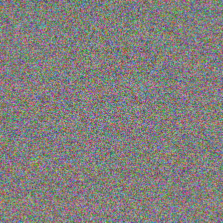
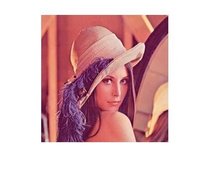
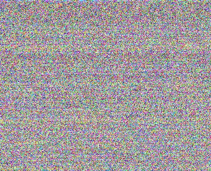
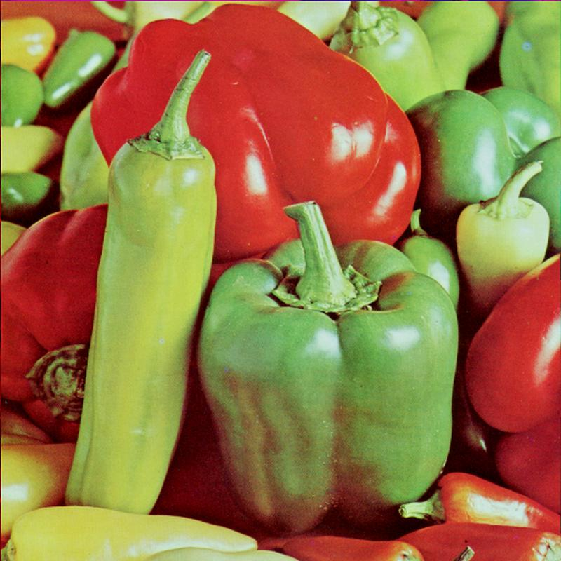
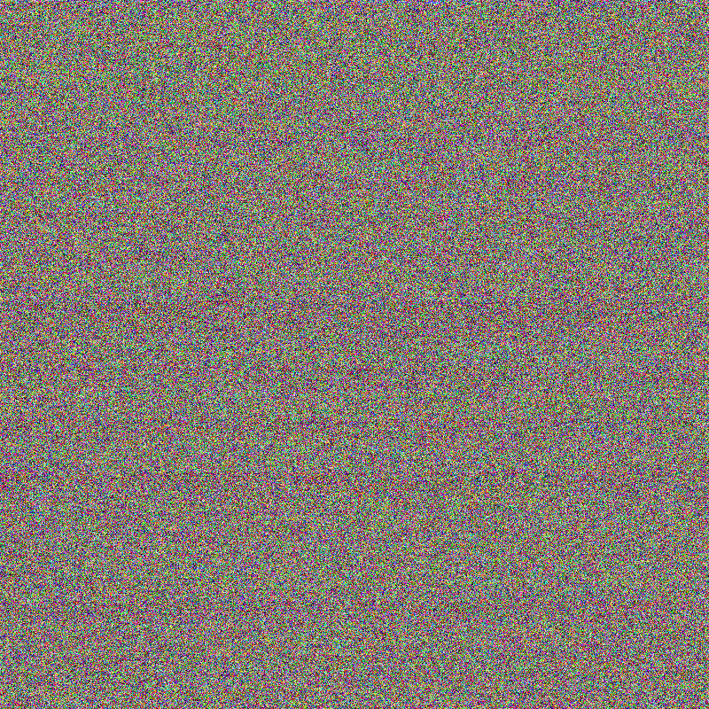

# DNA-Based Image Encryption Using MD5 and the Lorenz System


[](https://colab.research.google.com/github/USERNAME/dna-lorenz-image-encryption/blob/main/notebooks/DNA_Lorenz_MD5.ipynb)

Python implementation of **DNA_LorenzMD5**, a color-image encryption scheme developed as a
Bachelor of Science graduation project at the **University of Khartoum**, Faculty of
Mathematical Sciences and Informatics, Department of Computer Science (February 2023).

> **Research prototype.** Built for study and experimentation. Do not use it to protect real
> sensitive data. MD5 is no longer considered collision-resistant.

## Table of contents

- [Overview](#overview)
- [Examples](#examples)
- [Results](#results)
- [Installation](#installation)
- [Usage](#usage)
- [Repository structure](#repository-structure)
- [Limitations](#limitations)
- [Authors](#authors)
- [Citation](#citation)
- [License](#license)

## Overview

The scheme combines DNA coding, an MD5-derived key, and chaotic scrambling from the Lorenz system:

1. **Key generation**: MD5 of the user secret plus the image pixel data (a plain-image-related key).
2. **DNA encoding**: each of the R, G, B channels is converted to bits, then to DNA bases
   (`00=A, 01=T, 10=G, 11=C`). The key is encoded the same way.
3. **DNA XOR**: the encoded channels are XORed with the encoded key matrix.
4. **Chaotic sequences**: the hash gives the Lorenz initial conditions `(x0, y0, z0)`.
   The system is solved with `scipy.integrate.odeint`, and the sorted order of each of
   `x, y, z` gives a permutation index.
5. **Scrambling**: each channel is permuted using its index sequence.
6. **DNA decoding**: bases are converted back to bits and packed into the cipher image.

Decryption applies the inverse steps in reverse order.

## Examples

Standard benchmark test images (Baboon, Lenna, Pepper): original, encrypted, and decrypted.

| Image  | Original | Encrypted | Decrypted |
|:------:|:--------:|:---------:|:---------:|
| Baboon |  |  |  |
| Lenna  |  |  |  |
| Pepper |  |  |  |

## Results

Reported in the project paper (Chapter 5):

| Image  | NPCR   | UACI   |
|--------|--------|--------|
| Lenna  | 99.45% | 22.27% |
| Baboon | 99.48% | 21.96% |
| Pepper | 99.46% | 22.55% |

- Encrypted-image histograms are close to uniform.
- Adjacent-pixel correlation drops to near zero after encryption.
- Reported speed: about 0.5154 Mbit/s.
- UACI is below the theoretical ideal (about 33.46%), so there is room for improvement.

## Installation

```bash
git clone https://github.com/USERNAME/dna-lorenz-image-encryption.git
cd dna-lorenz-image-encryption
pip install -r requirements.txt
```

## Usage

```bash
python src/dna_lorenz_encryption.py
```

```
Please enter file name:  77.png
Enter key: your-secret-key
```

The script saves `encrypt_<name>.png` and `recovered_<name>.png` next to the input image.

**Google Colab:** upload the image to `/content/`, open the notebook in `notebooks/`,
and run all cells in order.

## Repository structure

```
├── src/                 # Python source
├── notebooks/           # Colab notebook
├── images/              # Sample inputs and results
├── docs/                # Graduation project report (PDF)
├── requirements.txt
├── LICENSE
└── README.md
```

## Limitations

- Pure-Python pixel loops make it slow on large images. Start with small ones.
- Decryption runs in the same session, using in-memory values (`fx, fy, fz`, key matrix).
  Standalone decryption from the saved file alone is not implemented.
- MD5 is used to follow the original paper; it is not suitable for modern security needs.

## Authors

- Mohammed Nsraldeen Abdallah
- Toga Abdelazim Omer
- Yosra Adil Abubakr

**Supervisor:** Dr. Huwaida Tagelsir Elshoush, University of Khartoum

## Citation

```bibtex
@thesis{dna_lorenz_md5_2023,
  title  = {A New DNA Based Image Encryption Method Using MD5 and Lorenz System},
  author = {Abdallah, Mohammed Nsraldeen and Omer, Toga Abdelazim and Abubakr, Yosra Adil},
  school = {University of Khartoum},
  year   = {2023},
  type   = {B.Sc. graduation project}
}
```

## License

Released under the MIT License. See [LICENSE](LICENSE).
